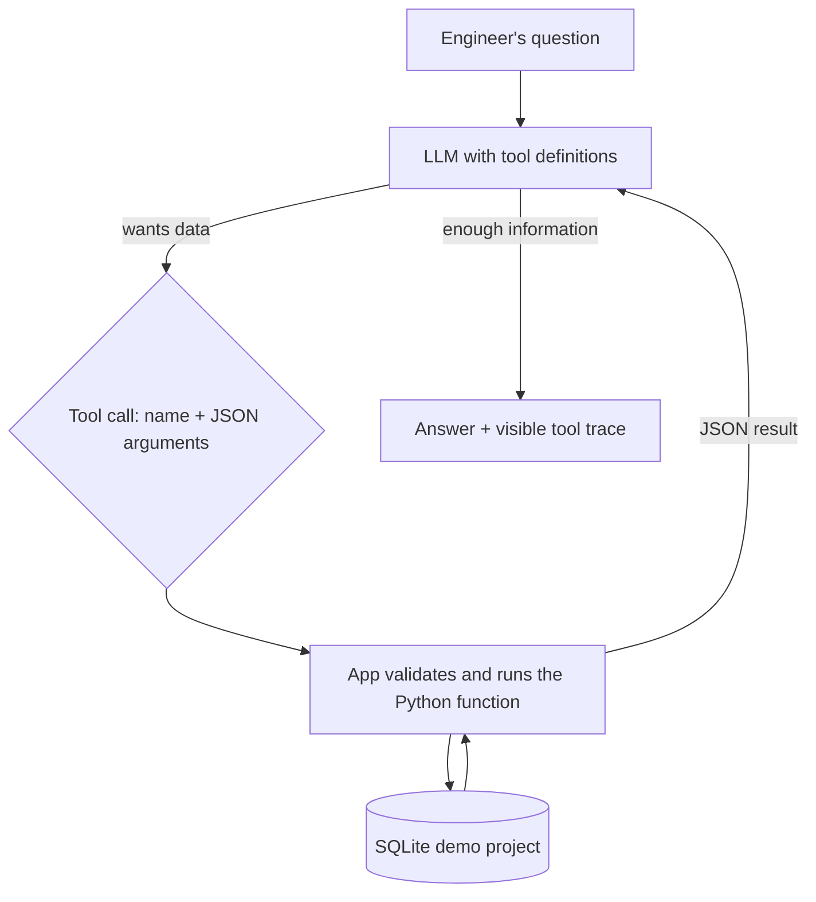

# 🔌 Electrical Project Assistant (Tool-Calling Agent)

An AI agent that works with **electrical project data** — parts, devices, cables, cabinets — by calling Python functions. It can look up devices, search the part master data, **check cable protection and voltage drop**, generate a **bill of materials** and draft **change requests**.

It is a proof of concept for how an LLM could be connected to engineering data (for example data exported from or accessed through an EPLAN-based design process): the engineer asks in plain language, and the agent uses well-defined, tested functions to get exact answers.

> The project "P24017 Airport BHS – Line 3", its parts and rule values are **fictional demo data**. Two cables are deliberately under-sized so the checks have something to find.

## How it works



1. The LLM receives the question plus a description of every available tool (name, purpose, JSON parameters).
2. If it needs data, it replies with a **tool call** instead of text. The app runs the matching Python function — the model never touches the database directly.
3. The result goes back to the model. This loop repeats (max. 6 steps) until the model can answer.
4. Every tool call and its result is shown in the UI ("Agent steps"), so engineers can verify where an answer came from.

## Tools

| Tool | What it does |
|---|---|
| `search_parts` | Search the part master data by text, category, minimum current |
| `get_device` | Device details by tag (accepts `F14`, `-F14` or `=BHS3+CAB1-F14`) incl. connected cables |
| `list_cabinet_devices` | All devices in CAB1, CAB2 or FIELD |
| `check_cable_protection` | Protective device rating vs. cable cross-section, for one cable or the whole project |
| `calculate_voltage_drop` | Three-phase voltage drop vs. the 3 % limit |
| `generate_bom` | Bill of materials with quantities and prices |
| `create_change_request` | Creates a **draft** change request (only on explicit request; needs human approval) |

Design decisions:
- **Calculations are done in code, not by the LLM** — the model decides *what* to check, Python computes the numbers.
- **Read tools vs. write tools:** the only write action creates a *draft*, validates all tags first and never changes design data.
- Parameterised SQL only; wrong arguments are returned to the model as an error instead of crashing.

## Stack
- Python, Streamlit, SQLite
- OpenAI Python library (Chat Completions + function calling) pointed at **Google Gemini's OpenAI-compatible API** (free tier). Works with OpenAI or other compatible providers by changing key, base URL and model.

## Run locally

```bash
python -m venv .venv
.venv\Scripts\activate          # Windows
pip install -r requirements.txt
copy .env.example .env          # put your key into .env
streamlit run app.py
```

Free Gemini API key: https://aistudio.google.com/apikey

## Deploy (Streamlit Community Cloud, free)
1. https://share.streamlit.io → **Create app** → this repo, branch `main`, file `app.py`.
2. **Advanced settings → Secrets**:
   ```toml
   GEMINI_API_KEY = "your key"
   ```
3. Deploy.

## Possible next steps
- Replace the SQLite demo data with a real export (parts lists, device tags, cable lists) or an API of the design tool
- Role-based permissions per tool; approval workflow for write actions
- Combine with the RAG assistant so the agent can also cite the design standard behind each rule
