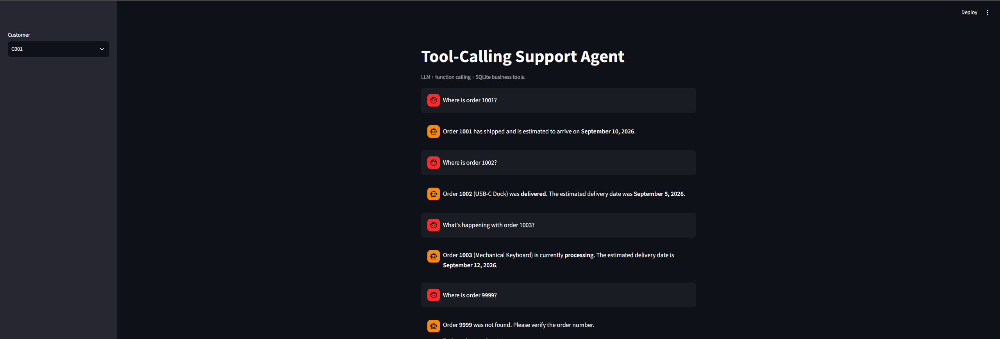

# Tool-Calling Support Agent

A compact customer-support agent demonstrating **LLM tool calling** with the OpenAI Responses API.

The model can decide when it needs application data and call normal Python functions:

- `get_order_status`
- `get_customer_orders`
- `create_support_ticket`

The tools use a small local SQLite database, so the project is fully runnable without another backend.

## Architecture



```text
Customer message
       |
       v
OpenAI Responses API
       |
       +---- decides to call a tool
       |
       v
Python tool function
       |
       v
SQLite database
       |
       v
Tool result
       |
       v
OpenAI Responses API
       |
       v
Final customer response
```

## Run

```bash
python -m venv .venv
# Windows
.venv\Scripts\activate
# macOS/Linux
source .venv/bin/activate

pip install -r requirements.txt
copy .env.example .env
streamlit run app.py
```

## Demo questions

Use customer ID `C001` in the sidebar and try:

- `Where is order 1001?`
- `Show my recent orders.`
- `My order is late. Please create a support ticket.`

